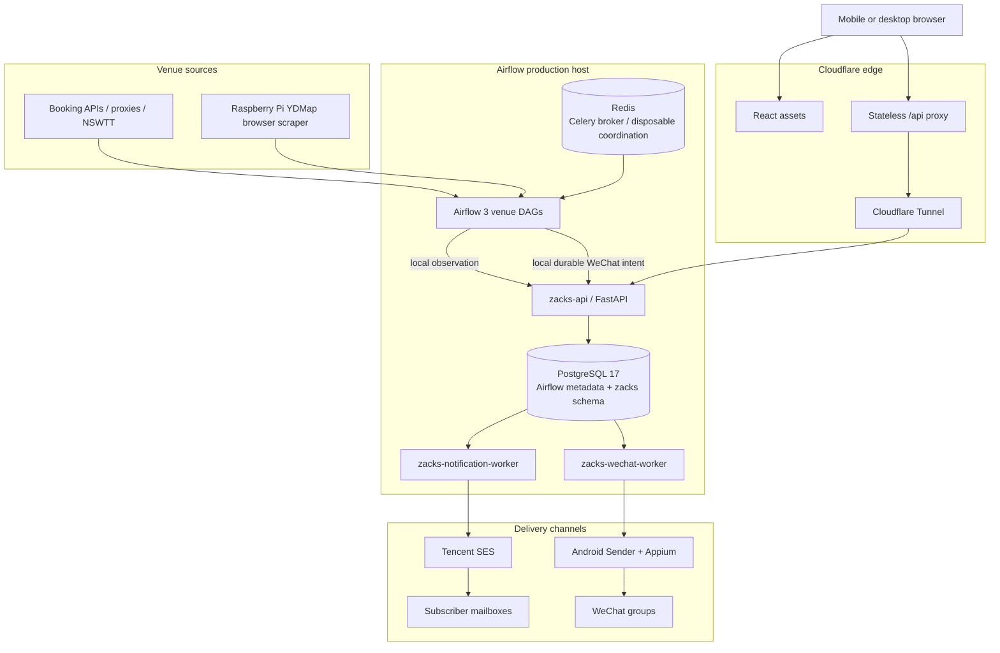

# 🎾 WeChat-on-Airflow

> Shenzhen tennis availability alerts: Apache Airflow 3 performs high-frequency venue polling, the PostgreSQL notification core on the Airflow host owns subscriptions, email, and WeChat gating, and Cloudflare is only the public edge.

[English](./README.en.md) · [中文](./README.md)

[](https://github.com/claude89757/wechat-on-airflow/actions/workflows/ci.yml)
[](https://www.python.org/)
[](https://airflow.apache.org/)
[](https://www.postgresql.org/)
[](LICENSE)

## ✨ Features

- **Multi-venue polling**: 27 Shenzhen venue DAGs. Shenzhen Bay polls every two minutes and Greater Bay Area every three minutes, from 08:00 inclusive to 21:00 exclusive in Asia/Shanghai. Three CRLand accounts rotate by each venue's scheduled round. Dashah International and Bao'an Tennis Center share one browser-task slot and poll every two minutes. Other venues use the one-minute default or an explicit policy.
- **Host-owned subscription core**: local `zacks-api` accepts observations and Web requests; PostgreSQL schema `zacks` stores identities, subscriptions, dedupe state, Outboxes, quotas, and delivery results.
- **Subscriber email**: `zacks-notification-worker` performs matching, digesting, weather policy, standard and priority quotas, Tencent SES submission, backoff retries, and delivery reconciliation.
- **WeChat alerts**: venue tasks only write the PostgreSQL delivery queue. The separate `zacks-wechat-worker` calls the Android Sender. The device keeps a durable idempotency record so a restart does not send the same message again.
- **Stateless Cloudflare edge**: the Worker serves React assets and proxies `/api/*` with no business state. After migration, D1 has no runtime binding and is kept only as an unbound archive.
- **Failure isolation**: a Cloudflare or D1 failure does not stop email or WeChat for existing subscriptions. Losing Redis cannot lose or duplicate a notification. A failure in one delivery channel does not overwrite the other.
- **Exact-commit releases**: GitHub Actions is the only production control plane. Every component is released and accepted by full commit SHA.
- **Complete quality gate**: `make verify` covers Ruff, mypy, Python tests, Web/Worker tests, browser regression, Compose, images, and Airflow DagBag contracts.

## 🏗️ Architecture



### Core principles

1. **PostgreSQL is the only durable business source of truth.** It owns users, subscriptions, venue status, event identities, notification Outboxes, daily limits, and provider status.
2. **Redis is not authoritative.** It remains the Celery broker and may provide wake-ups or hot cache entries, but notification correctness never depends on Redis persistence.
3. **Exactly one email owner is active.** The first cutover freezes the previous owner, imports and verifies data, then lets the host worker deliver alone. There is no dual-write path and no legacy runtime fallback.
4. **WeChat does not depend on Cloudflare.** The dedicated WeChat worker decides from PostgreSQL subscriptions and live availability. Venue DAGs do not wait for the device to send.
5. **Cloudflare is an edge boundary only.** It provides static assets, TLS/WAF, stateless API forwarding, and Tunnel ingress. It does not query D1, run a notification Cron, or own the notification decision.
6. **After failure, pause safely and roll forward.** The first cutover uses a maintenance window, encrypted secret transfer, batched import, and table-by-table verification. After activation, D1 is not imported again, the old design is not restored automatically, and the original business data is not deleted.

Current production state is established only by an exact-commit acceptance report from the protected workflow. This page does not by itself mean the migration is finished. Acceptance includes three natural cycles for all 27 active venue DAGs, the production transaction-rollback subscription probe, and real natural email and WeChat delivery records.

See [ARCHITECTURE.md](./ARCHITECTURE.md) and [ADR 0013](./docs/adr/0013-host-core-only-reliable-delivery.md).

## 🧱 Tech Stack

| Component | Role |
| --- | --- |
| Apache Airflow 3.3.0 (CeleryExecutor) | Venue polling, scheduling, and orchestration |
| Python 3.12 | Venue adapters, API, migration, and notification worker |
| PostgreSQL 17 | Airflow metadata plus the isolated `zacks` business schema |
| Redis | Celery broker and optional disposable coordination |
| FastAPI + Uvicorn | Local subscription and observation API |
| Tencent SES | Verification, lifecycle, and subscriber email |
| Android + Appium (systemd) | WeChat group sender |
| React + Cloudflare Worker | Static Web application and stateless edge proxy |
| Cloudflare Tunnel | Secure public ingress for Airflow and `zacks-api` |

Public endpoints: Airflow console `https://airflow.claude89757.cc` · subscription site `https://courts.zacks.vision` (`https://zacks.claude89757.cc` remains reachable)

## 📁 Repository Layout

```text
├── dags/                              # Production DAG wiring only
├── pi_host/                           # Raspberry Pi YDMap browser scraper
├── src/wechat_airflow/
│   ├── venues/                        # Venue APIs, parsing, filtering
│   ├── host_core/                     # PostgreSQL API, matching, migration, email and WeChat workers
│   ├── notifications/                 # Observation client, WeChat client, booking-link policy
│   ├── proxy_tools/                   # Proxy refresh
│   └── maintenance/                   # Android maintenance
├── webapp/
│   ├── src/                           # React client
│   └── cloudflare/                    # Stateless edge; D1 is an unbound migration archive
├── config/
│   ├── active-components.yaml
│   ├── runtime-target.yaml
│   └── host-core-contract.yaml
├── scripts/                           # Idempotent development and production operations
├── docker/                            # Reproducible runtime images
├── docs/                              # ADRs, runbooks, architecture, evidence
└── tests/                             # Unit, contract, migration, browser, DagBag tests
```

## 🚀 Quick Start

Requires Python 3.12, Node 24, and Docker Compose v2:

```bash
make setup
make local-secrets
make verify
```

Tests, CI, and normal health checks **never** send real email or WeChat messages.

The local Compose runtime includes:

```text
postgresql
redis
airflow-api-server
airflow-scheduler
airflow-dag-processor
airflow-worker
airflow-triggerer
zacks-api
zacks-notification-worker
zacks-wechat-worker
```

The first production cutover must use the protected `Production Host Core` workflow and the [host-core cutover runbook](./docs/runbooks/host-core-cutover.md). Do not replace it with an ordinary Web deployment.

## 📖 Documentation

| Document | Purpose |
| --- | --- |
| [ARCHITECTURE.md](./ARCHITECTURE.md) | Current architecture and failure boundaries |
| [AGENTS.md](./AGENTS.md) | Repository operating and safety invariants |
| [config/host-core-contract.yaml](./config/host-core-contract.yaml) | Machine-readable host-core ownership contract |
| [docs/adr/0012-airflow-host-notification-core.md](./docs/adr/0012-airflow-host-notification-core.md) | Architecture decision and migration principles |
| [docs/runbooks/host-core-cutover.md](./docs/runbooks/host-core-cutover.md) | Host cutover, acceptance, and roll-forward |
| [docs/release-strategy.md](./docs/release-strategy.md) | Exact-commit release strategy |
| [SECURITY.md](./SECURITY.md) | Security policy |

## 🔐 Configuration and Security

- The protected GitHub Environment stores deployment identities, not business state.
- Airflow Variables store venue configuration and emergency switches, not growing business history.
- PostgreSQL schema `zacks` stores all durable application state.
- Tencent SES credentials live in root-owned host Secret files. During migration they are transferred directly through an ephemeral RSA-OAEP/AES-GCM envelope; GitHub never receives plaintext.
- D1 deletion, business-data cleanup, secret rotation, and database replacement are separately approved high-risk operations.

## 🤝 Contributing

See [CONTRIBUTING.md](./CONTRIBUTING.md), [SECURITY.md](./SECURITY.md), and [CODE_OF_CONDUCT.md](./CODE_OF_CONDUCT.md).

## 📄 License

MIT License. See [LICENSE](./LICENSE).
